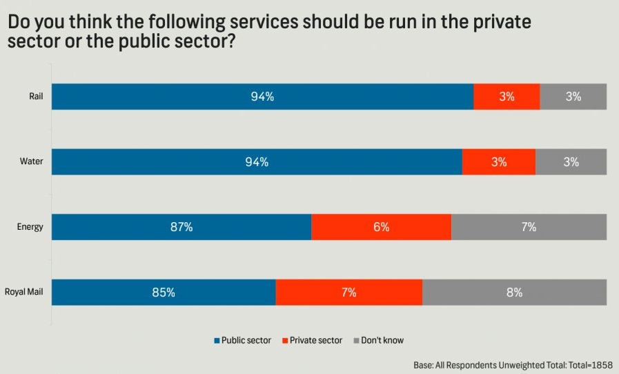

# Introduction

## Goal

The following chart was [shared](https://x.com/GraphCrimes/status/1566264004288331776) by @GraphCrimes on X/Twitter on September 3, 2022.

Our ultimate goal in this code along is to identify aspects of misrepresentation in this plot and then to correct them.

{fig-alt="Segmented bar char of sector and services." fig-align="center"}

## Packages

We will use the **tidyverse** package for data wrangling and visualization.

```{r}
#| message: false
library(tidyverse)
```

## Data

These data come from [Survation](https://www.survation.com/) and were recreated from the percentages noted on the segmented bar chart above.

```{r}
#| label: load-population-data
#| message: false
survation <- read_csv(
    "https://data-science-with-r.github.io/data/survation.csv"
)
```

Let's take a look at the data.

```{r}
#| label: view-survation-data
survation
```

# Analysis

## Critique

What is misleading about this graph?

Percentages indicated on the plot don't match the percentage of the length of the segment taken up in each bar.

## Recreate and improve

-   Confirm that the data match the percentages from the visualization. That is, calculate the percentages of public sector, private sector, don’t know for each of the services and check that they match the percentages from the plot.

```{r}
#| label: calculate-percentages
survation_longer <- survation |>
  pivot_longer(
    cols = !ID,
    names_to = "service",
    values_to = "sector"
  )

survation_longer |>
  count(service, sector) |>
  group_by(service) |>
  mutate(prop = n / sum(n))
```

-   Create an improved version of the visualization. Your improved visualization:

- should also be a segmented bar chart with services on the y-axis and presented in the same order as the original plot; sectors should create segments of the plot using the same colors (`gray`, `#FF3205`, and `#006697`) and appear in the same order as the original plot

- should have the same legend location

- should have the same title and caption

- does not need to have a bolded title or a gray background

- does not need to show percentages in the segments

```{r}
#| label: recreate

survation_longer |>
  mutate(
    service = fct_relevel(service, "Royal Mail", "Energy", "Water", "Rail")
    ) |>
    ggplot(aes(y = service, fill = sector)) +
    geom_bar(position = "fill") +
    scale_fill_manual(
      values = c(
        "Don't know" = "gray",
        "Private sector" = "#FF3205",
        "Public sector" = "#006697"
      )
    ) +
    theme(legend.position = "bottom") +
    guides(fill = guide_legend(reverse = TRUE))
```

-   How does the improved visualization look different than the original? Does it send a different message at a first glance?


